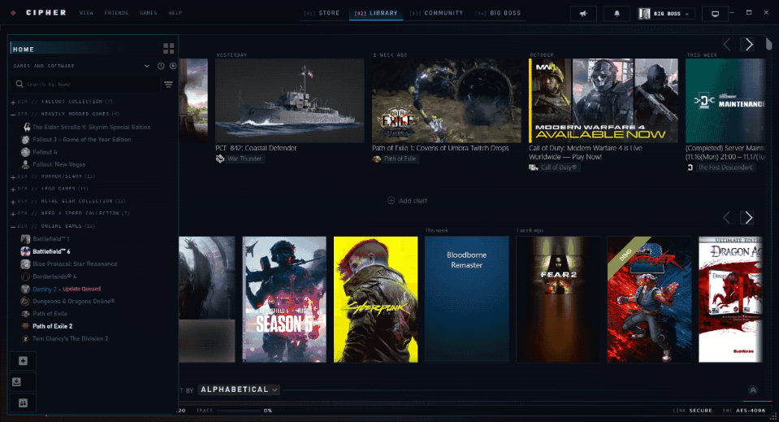
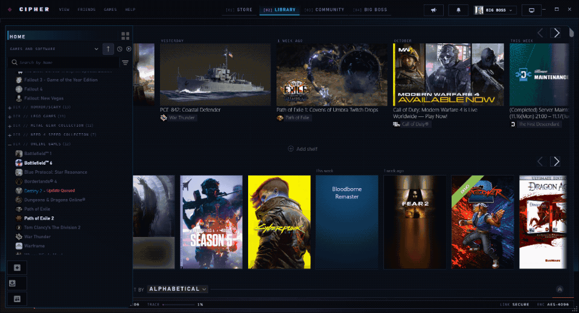

# Cipher

**A restricted operating system in a dystopian megacity.** Blue-black, neon cyan, magenta and electric purple. A [Millennium](https://steambrew.app) theme for the Steam client.

- **The classified database:** the game list is a slim locked rail on the far left with a data stream and a vertical stamp. Hover it and it slides open over the page; move away and it locks again (or keep it open in options).
- **Access-code navigation:** [01] STORE, [02] LIBRARY, [03] COMMUNITY, [04] PROFILE.
- **Trace monitor** as a status strip along the foot: clock, node, session time, a trace level that creeps up the longer you stay, and link status (LIVE OP while a game runs).
- **Subject-file game pages:** scanlined hero art with a clearance stamp, a cyan Play button that glitches to magenta on hover.
- Scanlines, a scanning band, rare heading glitches, a comms-terminal friends list, system-alert notifications and a clearance check on boot.

## Install

1. Install [Millennium](https://steambrew.app).
2. Find **Cipher** in the Millennium theme browser, or download this repository into `Steam/millennium/themes/Cipher`.
3. Open **Steam → Millennium → Themes** and pick **Cipher**.

## Options

Open **Millennium → Themes → Cipher** to change:

Palette (Neon, Toxic, Ultraviolet, Redline) · Database rail · Glitches · Scanlines · Density · What's New · Readout · Startup screen · Motion · Privacy · Contrast · Focus rings · Text size

Everything here is original: no other game's names, logos, art or fonts. Fonts are ones that ship with Windows.

## License

MIT, see [LICENSE](LICENSE).
